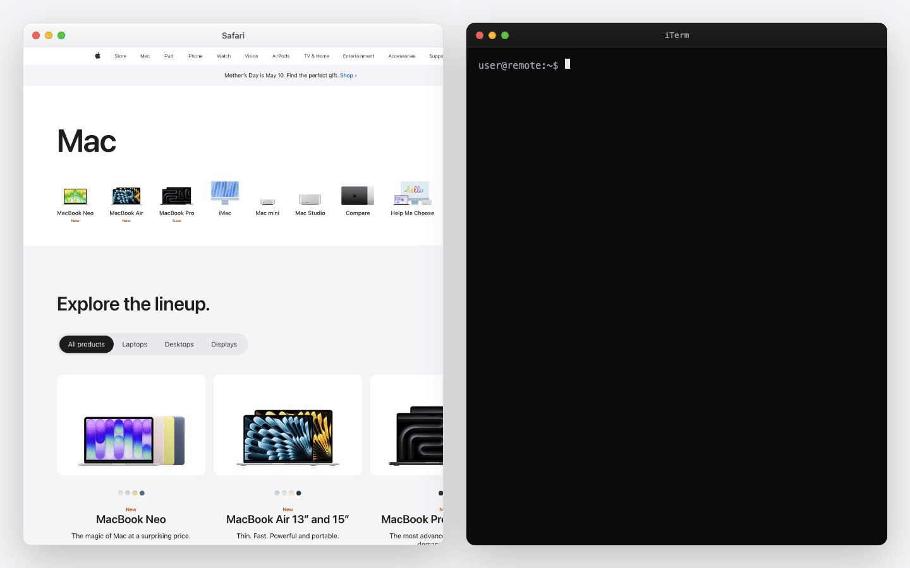

<div align="center">
  <picture>
    <source media="(prefers-color-scheme: dark)" srcset="assets/brand/icon.svg">
    <source media="(prefers-color-scheme: light)" srcset="assets/brand/dark_icon.png">
    
  </picture>
  <h1>clipport</h1>
  <p><strong>Paste Mac clipboard text, images, and screenshots into remote iTerm SSH sessions.</strong></p>
  <p>
    <a href="LICENSE"></a>
    
    
    
  </p>
</div>

Clipport lets you share images and screenshots over SSH without saving files by
hand or running one-off `scp` commands. One iTerm paste shortcut works across
local and remote shells: Clipport detects the active session, reads the Mac
clipboard, and chooses the right paste behavior.

If your Mac clipboard has text, the remote shell receives text. If it has an
image or screenshot, Clipport uploads it over SSH and inserts the remote path.

| Session | Clipboard | Terminal receives |
|---|---|---|
| local | text, image, or screenshot | native paste; `clipctl paste` prints nothing |
| configured remote | text | clipboard text |
| configured remote | screenshot or image | remote file path under `/tmp/clipport/...` |
| unconfigured remote | any | session-matching error; use native paste instead |

Keep **Cmd+V** for native paste and use **Cmd+Shift+V** for Clipport. The current
local-paste implementation simulates Cmd+V, so binding Clipport to Cmd+V can
trigger itself repeatedly. Remote sessions that cannot be matched do not fall
back to native paste.

## Demo



Remote image or screenshot example:

```text
/tmp/clipport/yourname/clipboard-20260428-132708.241851.png
```

Use Clipport when a remote process needs the thing on your Mac clipboard: a
screenshot, an image, or plain text pasted through the same terminal shortcut.

## Use Cases

Clipport is useful when the remote shell needs local clipboard state:

- paste a screenshot path into a VM shell
- hand a local image to a remote command
- avoid one-off `scp` for screenshots and clipboard images
- keep one paste shortcut for local and SSH shells

## Requirements

- macOS
- iTerm2
- Homebrew
- passwordless SSH to each remote machine
- writable `/tmp` on each remote machine

Uploads create files with mode `0600` inside `0700` directories. Existing upload
directories owned by the remote SSH account are tightened before writing new
content. `/tmp/clipport` must be absent or owned by that account; symlinked or
foreign-owned directories and existing destination files are rejected. Existing
files are not overwritten or retroactively changed.

## Quick Start

```bash
brew install arihantsethia/tap/clipport
clipctl onboard
```

Answer **Y** to configure the iTerm shortcut and automatic SSH session matching.
Onboarding starts or restarts Clipport; do not run `clipctl start` again afterward.

Open a new SSH session to a selected host in iTerm. Copy text or a screenshot
to your Mac clipboard and press **Cmd+Shift+V** in that session. Keep **Cmd+V**
for ordinary paste, including on unconfigured servers.

Run `clipctl doctor` in a separate **local Mac pane**. Its `forward` check tests
the optional remote clipboard tunnel, which needs [remote clipboard setup](#remote-clipboard-shims)
and an open SSH connection. Onboarding alone does not set up that tunnel.

## Install

```bash
brew install arihantsethia/tap/clipport
```

Homebrew installs `clipctl`, `clipportd`, and the Clipport menu bar app.
`clipctl onboard` records the local app paths in
`~/.config/clipport/config.toml` before configuring SSH routes.

Manual install without Homebrew tap:

```bash
curl -fsSL https://raw.githubusercontent.com/arihantsethia/clipport/main/install.sh | sh
```

## Setup

Build host config from `~/.ssh/config`:

```bash
clipctl onboard
```

Onboarding lets you choose SSH hosts, configure the iTerm paste shortcut, and
install OpenSSH `LocalCommand` hooks for automatic session matching. Answer **Y**
to both prompts. It also starts or restarts the installed app.

Wait a few seconds for the daemon to become ready before checking it. If you
need to restart it later, run this on your Mac:

```bash
clipctl restart
```

Open a **new** SSH connection in iTerm after onboarding so the session hook runs.
Existing connections do not pick up SSH config changes. In a separate local Mac
pane, check the install:

```bash
clipctl doctor
```

The daemon and HTTP API checks should pass. A failed `forward` check is separate
from ordinary shortcut pasting: it checks the tunnel used by remote clipboard
shims. See [Remote Clipboard Shims](#remote-clipboard-shims) to set that up.

Copy text on your Mac and press **Cmd+Shift+V** in the SSH session. Text should
appear at the remote prompt.

For images and screenshots, copy the clipboard item and press the same shortcut.
The remote prompt receives a path like:

```text
/tmp/clipport/yourname/clipboard-20260428-132708.241851.png
```

Test remote image upload without changing your clipboard:

```bash
clipctl test-paste --host <machine>
```

Run that command on your Mac, replacing `<machine>` with the machine name chosen
during onboarding. It checks upload behavior, not the iTerm shortcut itself.

### Check the iTerm shortcut

Open **iTerm2 → Settings → Keys → Key Bindings** and inspect **Cmd+Shift+V**.
Its command should be the absolute path to your installed `clipctl`, followed
by `paste`, for example:

```text
/Users/yourname/.local/bin/clipctl paste
```

Run `command -v clipctl` on your Mac to check the installed path. Also inspect
**Profiles → your active profile → Keys → Key Mappings**: a profile binding can
override the global shortcut. `clipctl doctor` finding a saved binding does not
prove that the active profile invokes it.

Keep Cmd+V assigned to native paste. Use it for servers you have not configured
in Clipport; the Clipport shortcut reports an error for an unmatched remote
session. Local Clipport paste simulates Cmd+V and therefore requires Cmd+V to
remain a native-paste shortcut.

## Behavior

iTerm runs this command behind the paste shortcut:

```bash
clipctl paste
```

Stdout is strict because iTerm inserts stdout into the terminal:

- local paste prints nothing
- remote text prints the clipboard text
- remote image upload prints only the remote path

Remote uploads always use paths under:

```text
/tmp/clipport/<local-user>/
```

## Configuration

A machine is one remote filesystem. A route is one SSH path to that machine.
OpenSSH still owns aliases, keys, proxies, and connection behavior.

Rerun onboarding:

```bash
clipctl onboard
```

List SSH hosts seen by onboarding:

```bash
clipctl onboard --list
```

Local install settings and host routes live in:

```text
~/.config/clipport/config.toml
```

The file contains no secrets.

## Session Matching

Clipport maps the active iTerm session to a configured machine. OpenSSH
`LocalCommand` hooks make that mapping explicit. If hooks are not installed or
do not fire, terminal title detection and manual registration remain available.

Register the current iTerm session manually:

```bash
clipctl session register --machine <machine>
```

Show configured hosts, registered sessions, and recent transfers:

```bash
clipctl status
```

## Menu Bar

When started, the menu bar app supervises `clipportd`. It shows daemon health,
configured hosts, and shortcuts to restart Clipport, run `clipctl doctor`, and
open config or log files.

`clipportd` exits when the menu bar app exits. Choosing `Quit` stops the
daemon and exits Clipport. The menu bar app does not change the
`clipctl paste` stdout contract.

## Commands

```bash
# Paste entrypoint used by iTerm.
clipctl paste

# Start, stop, or restart the menu bar app and daemon.
clipctl start
clipctl stop
clipctl restart

# Health check.
clipctl doctor

# Status and recent transfers.
clipctl status

# Upload an embedded test PNG to a configured machine.
clipctl test-paste --host <machine>

# Update from the public installer source.
clipctl update
```

Debug paste failures:

```bash
clipctl --debug paste
```

## Remote Clipboard Shims

Shims are only for remote programs that call `wl-paste` or `xclip` directly.
Ordinary Clipport shortcut pasting does not require them. Onboarding installs
session-matching hooks, but does **not** install shims, a `RemoteForward` rule,
or the remote authentication token.

For remote clipboard access, run this **on your Mac** for each configured machine
(replace `<machine>` with its name from onboarding):

```bash
clipctl shims setup --host <machine>
```

This adds SSH forwarding rules for the machine's routes, installs the remote
shims, and copies your local Clipport token to the remote account. That token
allows remote clipboard access while the tunnel is connected.

Reconnect SSH using one of the configured route aliases and leave that session
open. Then run `clipctl doctor` in a local Mac pane. The `forward` check should
now pass. Reconnecting without first installing the forwarding rule and token
will not fix a missing tunnel.

Both local and remote tokens live at:

```text
~/.config/clipport/token
```

Permissions are `0600`. Tokens are not embedded in executable scripts. The
local HTTP endpoint binds only to loopback.

Remove shims:

```bash
clipctl shims uninstall --host <machine>
```

Remove the remote token too:

```bash
clipctl shims uninstall --host <machine> --remove-remote-token
```

## Install Options

From a checkout:

```bash
./install.sh
```

Install binaries somewhere else:

```bash
CLIPPORT_BIN=/some/bin ./install.sh
```

Use a different iTerm key binding:

```bash
CLIPPORT_ITERM_KEY=<iterm-key-code> ./install.sh
```

Use a specific loopback HTTP address:

```bash
CLIPPORT_HTTP=127.0.0.1:18800 ./install.sh
```

## Update

For Homebrew installs, use Homebrew to install the latest published stable release:

```bash
brew update
brew upgrade arihantsethia/tap/clipport
clipctl restart
```

The tap checks for new releases hourly and updates only after macOS source and
formula tests pass. GitHub may delay scheduled runs. Maintainers can also run
[Update Clipport](https://github.com/arihantsethia/homebrew-tap/actions/workflows/update-clipport.yml)
manually. Each stable version has a versioned source URL and SHA-256 checksum.

For unreleased development changes, opt in with
`brew install --HEAD arihantsethia/tap/clipport`. Refresh an existing HEAD install
with `brew upgrade --fetch-HEAD arihantsethia/tap/clipport`, then `clipctl restart`.

For manual/source installs only:

```bash
clipctl update
```

`clipctl update` downloads the latest installer and applies it using the current
install settings.

Set `CLIPPORT_REF` to update from another branch or ref:

```bash
CLIPPORT_REF=<ref> clipctl update
```

## Uninstall

```bash
clipctl uninstall
```

Preview:

```bash
clipctl uninstall --dry-run
```

Remove local config, cache, token, and `/tmp/clipport` files:

```bash
clipctl uninstall --remove-data
```

By default, uninstall keeps local data and remote shim tokens.

## Troubleshooting

Start with:

```bash
clipctl doctor
```

Common cases:

- `Bootstrap failed: 5: Input/output error` after running `clipctl start`:
  onboarding may already have loaded the launch agent. Run `clipctl restart`,
  wait a few seconds, then rerun `clipctl doctor`. This error alone is not a
  reason to run Clipport as root.
- `daemon` or `http api` reports connection refused: the app may still be
  starting. If it persists after a restart, inspect `/tmp/clipport.err.log` and
  `/tmp/clipportd.err.log`. An `ok launchd` result only confirms the agent is
  loaded, not that the daemon is healthy.
- `forward` reports connection refused: if you need remote clipboard shims,
  run `clipctl shims setup --host <machine>` on your Mac, then reconnect SSH and
  keep the connection open. Use `ssh -G <ssh-alias>` locally to check that the
  effective configuration contains `remoteforward`. The default forwarded
  endpoint is `127.0.0.1:18765`.
- `forward` reports `401 Unauthorized`: the endpoint is reachable, but the
  remote token is missing or does not match. Rerun
  `clipctl shims setup --host <machine>` on your Mac to synchronize it, then
  rerun the check with SSH connected.
- Session matching fails despite `session hook already present`: that message
  does not verify the existing command's path. Inspect `ssh -G <ssh-alias>` on
  your Mac and check that `localcommand` uses your current `clipctl` executable.
  Back up `~/.ssh/config` before correcting a stale path, then reconnect SSH.
- LAN route fails: expected when off that network; Clipport tries the next
  route.
- SSH shell gets native paste: run
  `clipctl session register --machine <machine>` in that iTerm session.
- Hotkey does nothing: follow [Check the iTerm shortcut](#check-the-iterm-shortcut),
  then check `/tmp/clipportd.err.log`.
- Image upload fails: check passwordless SSH and remote write access to
  `/tmp/clipport`.

## Development

```bash
gofmt -w <changed go files>
go test ./...
go vet ./...
go build ./cmd/clipctl ./cmd/clipportd
CGO_ENABLED=1 go build -o /tmp/clipport-check ./cmd/clipport
```

See [ARCHITECTURE.md](ARCHITECTURE.md) for the contributor architecture map.
Report security issues using [SECURITY.md](SECURITY.md).

## License

Clipport is released under the [MIT License](LICENSE).

## Releases

See [RELEASING.md](RELEASING.md) for the tested tag-to-release and Homebrew update process.
